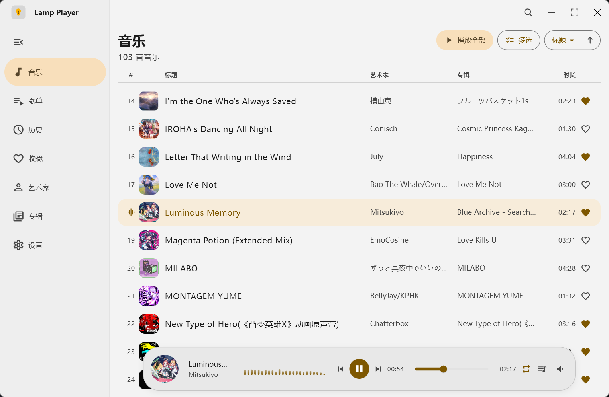
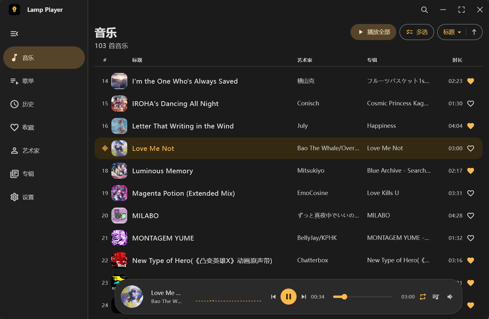
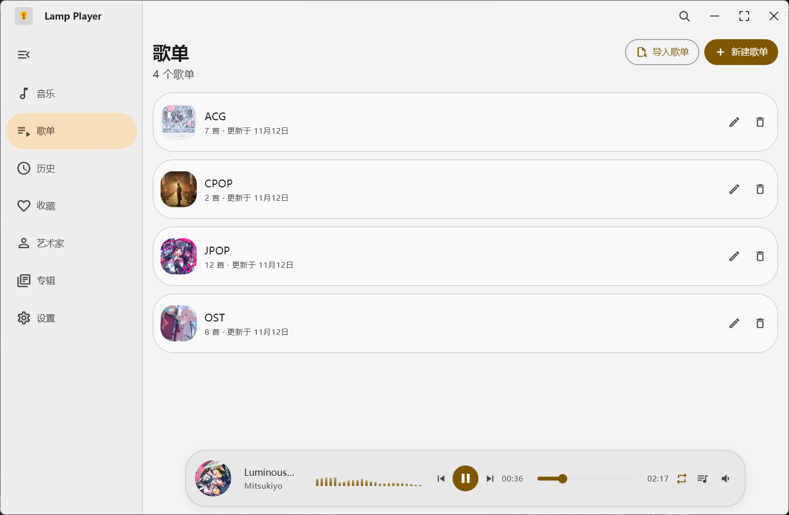
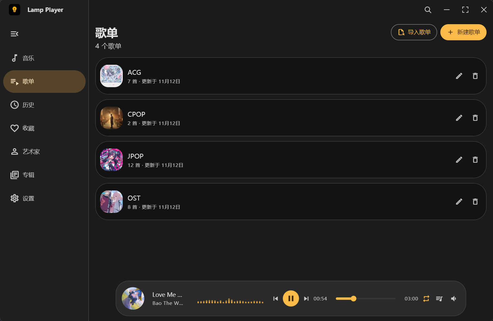
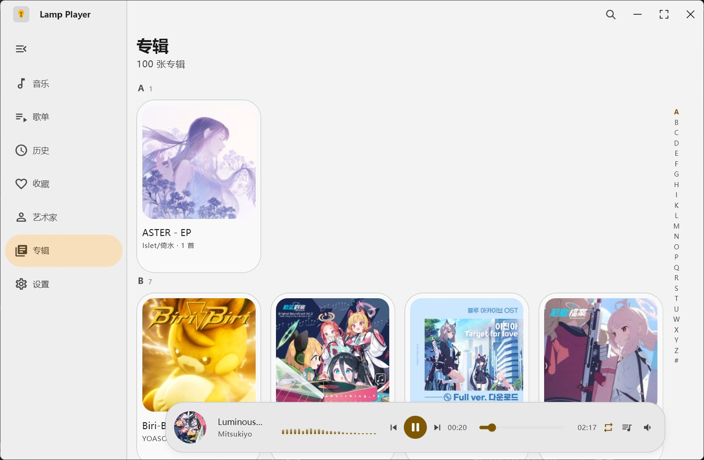
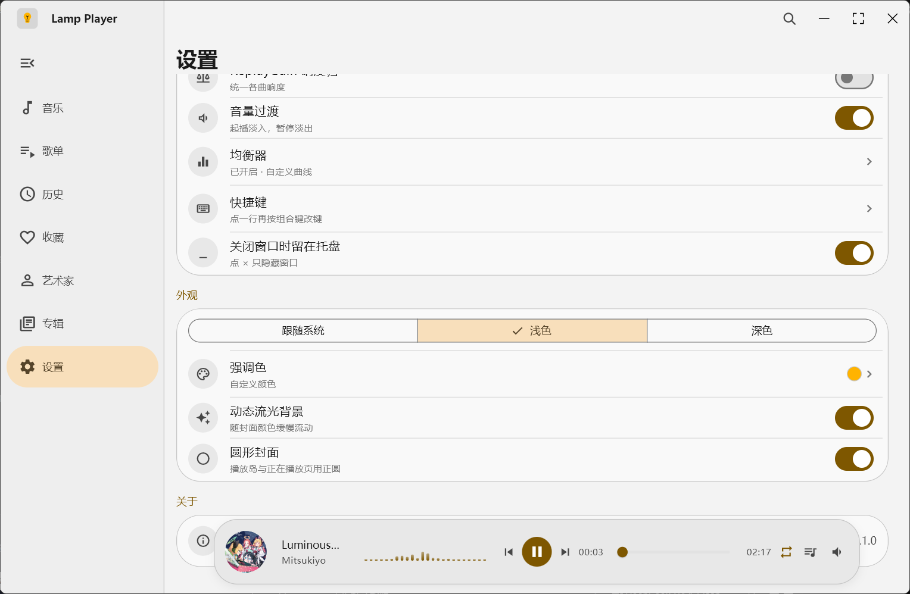
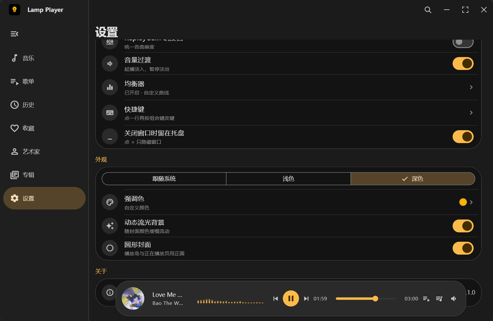

<p align="center">
  
</p>

<h1 align="center">Lamp Player</h1>

<p align="center">
  
  
  
  
  <a href="https://github.com/Linecos/lamp-player/actions/workflows/ci.yml">
    
  </a>
  <a href="LICENSE">
    
  </a>
</p>

<p align="center">基于 <b>Flutter + Rust + BASS</b> 的本地音乐播放器。</p>

## 界面预览

| 浅色主题 | 深色主题 |
|:---:|:---:|
|  |  |
|  |  |
|  |  |
|  |  |

## 特性

**界面与浏览**

- 🎨 Material 3 + 动态取色：九种调色板，浅色 / 深色 / 跟随系统，也可跟随当前封面
- 🅰️ 界面字体与歌词字体都能换成本机字体，弹窗里逐项字形预览
- 🧭 侧栏八个分区；曲库五种排序、万级曲目虚拟滚动、A-Z 导轨拖动定位
- 🔎 FTS5 全文检索：歌名 / 歌手 / 专辑，支持拼音与中文子串
- ✍️ 封面与元数据：内嵌图提取去重、12 个字段写回标签、多选批量处理

**播放与音频**

- ▶️ 播放控制与队列：自动连播、随机洗牌袋、循环、拖拽重排与直接跳播
- 🔊 WASAPI 独占输出（不重采样），设备掉线自动回落共享
- 🎚️ 0–8 秒换曲淡变、10 段均衡器、24 段频谱
- 📈 ReplayGain：三种参考响度、采样 / 真峰值限幅，可写回文件标签
- 🌙 睡眠定时：到点暂停或退出，没播完顺延到本曲结束
- 🎧 SMTC：媒体键、系统音量浮层、任务栏缩略图按钮

**歌词**

- 🎤 增强 LRC：逐字染色、翻译行、三种对齐、边缘渐隐与换行回弹
- 🪟 桌面歌词：独立置顶窗口，可双行（下一句或译文），字号字重可调

**曲库与系统**

- 🗂️ 歌单 / 收藏 / 历史（SQLite）；歌单可拖拽排序、导入导出 M3U
- 📥 添加目录增量入库；音乐库分区可清理缺失、隐藏歌曲、按音质分档统计
- 🖱️ 曲目右键菜单：入队、收藏、歌单、ReplayGain、定位文件、改元数据、用 MusicTag 打开
- 💾 会话恢复（音量、进度、队列、分区、窗口）与检查更新
- 🧷 单实例 + 托盘，关窗继续播放；快捷键全部可自定义
- 🦀 Rust 承担扫描、元数据与曲库内核；目前仅支持 Windows

> 支持格式：mp3、flac、wav、ogg、m4a / aac、ape、opus（wma 由系统编解码器播放，不参与扫描）。

## 架构

```
┌─────────────────────────────────────────┐
│         Flutter (Material 3 UI)         │
│         界面 / 交互 / 播放列表          │
└─────────────────────────────────────────┘
                   │ flutter_rust_bridge (类型安全 FFI)
┌─────────────────────────────────────────┐
│                Rust Core                │
│  ├─ scan         文件扫描 / 标签        │
│  ├─ db           SQLite + FTS5          │
│  ├─ collections  歌单 / 收藏 / 历史     │
│  ├─ metadata     标签与封面写回         │
│  ├─ player       BASS 播放控制          │
│  ├─ bass/        DLL 加载 / 独占 / FFT  │
│  └─ 系统集成     SMTC / 托盘 / 桌面歌词 │
└─────────────────────────────────────────┘
                   │ FFI (libloading)
┌─────────────────────────────────────────┐
│        BASS (bass.dll + add-on)         │
│        解码 / 混音 / 低延迟输出         │
│      basswasapi + bassmix 提供独占      │
└─────────────────────────────────────────┘
```

详细分层、数据流与扩展方式见 [ARCHITECTURE.md](docs/ARCHITECTURE.md)；
Rust 与 Dart 之间的接口约定见 [API_CONTRACT.md](docs/API_CONTRACT.md)。

## 技术栈

| 层 | 技术 |
|---|---|
| 界面 | Flutter 3.47 + Material 3 |
| 桥接 | flutter_rust_bridge v2.13 |
| 扫描 / 元数据 | Rust + `walkdir` / `lofty` |
| 曲库 | `rusqlite`（bundled SQLite + FTS5） |
| 音频 | [BASS](https://www.un4seen.com/) 2.4（add-on：flac / opus / ape / aac / wma；独占用 basswasapi + bassmix） |
| 安装包 | Inno Setup 6.5+（中文语言包随仓库） |

## 快速开始

系统要求：**Windows 10 及以上（64 位）**。

开发前置要求：Flutter SDK（含 Windows 桌面支持）、Rust（MSVC 工具链）、
Visual Studio 2022 或更高（C++ 桌面开发）、开启 Windows 开发者模式。

```powershell
git clone https://github.com/Linecos/lamp-player.git
cd lamp-player
.\scripts\bootstrap.ps1        # pub get + cargo fetch + 下载 BASS
flutter run -d windows
```

手动步骤（脚本做了什么）：

```powershell
flutter pub get
cargo fetch --manifest-path rust/Cargo.toml
.\scripts\setup-bass.ps1         # 从 un4seen 官网下载 BASS 2.4
.\scripts\setup-bass-output.ps1  # 独占输出所需 basswasapi / bassmix（可选）
.\scripts\setup-misans.ps1        # MiSans 歌词字体（可选，227 MB 官方包）
```

> BASS 为闭源第三方库，不随仓库分发（`third_party/bass/` 已 gitignore）。
> `scripts/setup-bass.ps1` 会下载 BASS 与官方 add-on（flac/opus/ape/wma）并校验 SHA256；
> m4a/aac 播放还需要 `scripts/setup-bass-plugins.ps1` 补 `bass_aac.dll`。
> 构建时 CMake 自动把它们拷到 exe 目录。
> `scripts/setup-misans.ps1` 从小米官网下载 MiSans 字体包，只取歌词用得上的常规一款
> （约 8 MB）放进 `assets/fonts/misans/`（已 gitignore），随安装包分发给用户；不跑这一步
> 只是歌词字体里没有 MiSans 选项，其余功能不受影响。
>
> Rust 装在非默认位置时，需设置 `RUSTUP_HOME` / `CARGO_HOME`。

打包（便携 zip / 安装包，产物在 `dist\`，已 gitignore）：

```powershell
.\scripts\package.ps1                 # 构建 release + 便携 zip + 安装包
.\scripts\package.ps1 -NoInstaller    # 只出便携 zip，不需要 Inno Setup
```

> 安装包由 Inno Setup 生成，需要本机装 Inno Setup 6.5 及以上；中文语言包已随仓库带在
> `installer/ChineseSimplified.isl`，默认按系统界面语言自动选中。

## 目录结构

```
├── lib/
│   ├── main.dart              入口：初始化桥接 + 挂载应用
│   └── src/
│       ├── app/               应用外壳、路由表、检查更新
│       ├── theme/             Material 3 主题、调色板、封面取色
│       ├── features/          页面：library（含各分区与子页面）、player（播放页 / 歌词 / EQ / 频谱 / 桌面歌词）、settings
│       ├── common/            通用组件与工具（滚动、音频评级、ReplayGain、字体、拼音）
│       └── rust/              frb 生成代码（禁止手改）
├── rust/
│   ├── src/api/               对 Dart 暴露的接口（db / collections / scan / player / metadata / lyrics / fonts / media …）
│   ├── src/bass/              BASS 动态加载、WASAPI 独占、FFT
│   ├── src/{scanner,smtc,single_instance,desktop_lyrics,…}.rs  扫描、系统集成、桌面歌词窗口
│   └── tests/                 Rust 集成测试
├── test/                      纯 Dart 测试（不依赖原生库，CI 跑这个）
├── integration_test/          桌面端集成测试（需真实原生库）
├── windows/                   Windows 宿主工程
├── installer/                 Inno Setup 安装包脚本与中文语言包
├── scripts/                   环境准备、检查、打包脚本
├── docs/                      架构、接口契约、性能报告、路线图
└── third_party/               第三方二进制与本地补丁（BASS 不入库）
```

## 参与贡献

欢迎提交 [Issue](https://github.com/Linecos/lamp-player/issues) 反馈 Bug，或者 fork 后提 [PR](https://github.com/Linecos/lamp-player/pulls)，流程见 [贡献指南](CONTRIBUTING.md)：

提交信息用中文 + Conventional Commits，例如 `feat(曲库): 支持按目录增量扫描`。

## 鸣谢与致敬

项目在开发过程中参考或使用了以下优秀项目：

- **[ZeroBit Player](https://github.com/Empty-57/ZeroBit-Player)**：Flutter + Rust + BASS 的一款优雅的桌面音乐播放器
- **[Coriander Player](https://github.com/Ferry-200/coriander_player)**：Flutter + Rust + BASS 的 Windows 本地音乐播放器，Material You 配色
- **[Salt Player](https://github.com/Moriafly/SaltPlayerSource)**：数十万用户选择的多平台本地音乐播放器
- **[Lyrico](https://github.com/Replica0110/Lyrico)**：歌词显示与编辑工具，支持逐字歌词、翻译与标签整理
- **[BASS](https://www.un4seen.com/)**：Un4seen 出品的音频解码与输出库，非商用免费
- **[Lofty](https://github.com/Serial-ATA/lofty-rs)**：Rust 音频元数据读写库，支持多种标签格式
- **[MusicTag](https://www.cnblogs.com/vinlxc/p/11347744.html)**：Windows 平台上的音频标签编辑工具

## 许可证

本项目代码以 [GNU Affero 通用公共许可证 v3.0](LICENSE)（AGPL-3.0）发布。

AGPL 是强 copyleft 协议：分发本程序或其修改版时必须一并提供完整源代码；如果把修改版作为
网络服务提供给别人使用，同样需要向他们提供源代码。个人在自己机器上使用不受这些义务影响。

注意：BASS 音频库由 [Un4seen Developments](https://www.un4seen.com/) 版权所有，
采用其自有许可（非商用免费），与本项目的 AGPL 许可相互独立。
