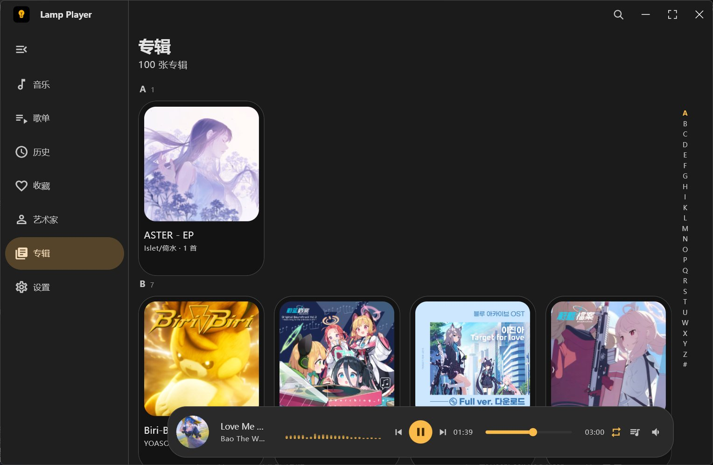

<p align="center">
  
</p>

<h1 align="center">Lamp Player</h1>

<p align="center">
  
  
  
  
  <a href="https://github.com/Linecos/lamp-player/actions/workflows/ci.yml">
    
  </a>
  <a href="LICENSE">
    
  </a>
</p>

<p align="center">基于 <b>Flutter + Rust + BASS</b> 的本地音乐播放器。</p>

> **当前状态**：M1 曲库闭环、M2 播放链路已完成，M3 打磨进行中——元数据写回、自定义封面、
> 音质分档、独占输出、ReplayGain、均衡器、增强 LRC 歌词与桌面歌词、听歌统计、界面字体都已落地；
> 本地能打出便携 zip 与安装包（`scripts/package.ps1`），发布流水线待接。任务清单见
> [docs/ROADMAP.md](docs/ROADMAP.md)。

## 界面预览

| 浅色主题 | 深色主题 |
|:---:|:---:|
|  |  |
|  |  |
|  |  |
|  |  |

## 特性

**界面与浏览**

- 🎨 Material 3 界面（Flutter），九种调色板 + 高对比，可跟随系统 / 浅色 / 深色，重启后保留
- 🌈 动态主题色：可跟随当前封面取色（浅色底也按种子色上色），切换主题是圆形揭示动画
- 🅰️ 界面字体与歌词字体可换成任意本机字体（设置 → 外观，弹窗里逐项用自身字形预览）
- 🧭 侧栏八个分区：音乐 / 歌单 / 历史 / 收藏 / 艺术家 / 专辑 / 音乐库 / 设置，可折叠
- 📚 曲库视图：五种排序（标题 / 艺术家 / 专辑 / 时长 / 最近添加）+ 升降序，万级曲目虚拟滚动
- 🔤 专辑、艺术家视图带右侧 A-Z 条，按住滑到哪跳到哪（带字母气泡）
- 🔎 FTS5 全文检索（歌名 / 歌手 / 专辑），支持拼音与中文子串兜底，输入 300ms 防抖；其余分区就地过滤
- 💿 音质分档：音乐库页的环形图按 Hi-Res / 无损 / 高码率 / 其他统计，点扇区或图例进入该档子页
- 🗂️ 音乐库分区：曲目统计、音乐目录（可进目录子页）、隐藏歌曲与清理缺失、听歌统计
- ✍️ 元数据编辑：歌名、艺术家、专辑等 12 个字段写回文件标签，封面可嵌入文件并回写曲库
- 🖼️ 封面：扫描时提取内嵌图，按内容哈希缓存去重；艺术家 / 专辑 / 歌单可自定义封面
- ☑️ 多选批量：播放所选、加入队列、收藏、加入歌单、隐藏（歌单内为移出）、批量计算 ReplayGain
- 🖲️ 滚轮平滑滚动；边缘渐隐与行高亮都跟着滚动走

**播放与音频**

- ▶️ 播放控制：上一首 / 下一首、播放全部、自动连播、随机（洗牌袋）与列表 / 单曲循环
- 🎛️ 播放队列面板：查看待播曲目、拖拽重排、直接跳播，底栏角标显示队列长度
- 🔊 独占输出：可在设置页切到 WASAPI 独占（经 bassmix 不重采样，绕过系统混音器），设备掉线自动回落共享
- 🎚️ 0 / 1 / 2 / 4 / 6 / 8 秒换曲淡变（共享输出为真交叉淡变）；10 段均衡器 + 预设
- 📊 频谱：24 段对数分频，只在出声时订阅
- 🔊 ReplayGain：-23 / -18 / -14 LUFS 参考响度，采样峰值 / 真峰值两种限幅口径；标签里已有的增益也能直接用
- 🌙 睡眠定时：定时暂停或退出，到点时没播完会顺延到本曲结束
- 🎧 系统媒体控制（SMTC）：媒体键 / 耳机线控 / 任务栏缩略图按钮可控制播放，Windows 音量浮层显示曲目、封面；媒体键按「谁在播放」路由，本应用空闲时不抢占别的播放器（不做 `RegisterHotKey`）

**歌词**

- 🎤 增强 LRC：逐字染色、翻译行、居中 / 左 / 右三种对齐、边缘渐隐与换行弹簧回弹
- 🪟 桌面歌词：独立置顶窗口，可换字体字号；也可把歌词写回文件标签或旁载 `.lrc`

**曲库与集合**

- 🗂️ 歌单 / 收藏 / 播放历史页面（SQLite 存储）；歌单支持拖拽排序、导入导出 M3U / M3U8
- 📥 添加音乐目录：系统目录选择 → 增量扫描入库，音乐库分区与空态均可进入
- 💾 会话恢复：音量、静音前音量、上次曲目与进度、播放队列、循环 / 随机、当前分区与侧栏状态；窗口尺寸与最大化状态
- 🔄 检查更新：手动检查 + 自动检查（每次启动 / 24 小时 / 7 天 / 30 天），发现新版本才提示

**系统与工程**

- 🧷 单实例 + 托盘：再次启动只会唤起已有窗口；关窗默认隐藏到托盘继续播放，托盘菜单可显示窗口或退出
- ⌨️ 快捷键可自定义（设置 → 快捷键）：默认空格播放 / 暂停、←/→ 快进 5 秒、Ctrl+←/→ 切歌、Ctrl+↑/↓ 音量、Ctrl+M 静音、Ctrl+F 搜索、Ctrl+L 定位正在播放；键盘媒体键也走同一张表
- 🖱️ 曲目右键菜单：播放、下一首播放、添加到队列、收藏、加入歌单、计算 ReplayGain、隐藏歌曲（歌单内为从歌单移除）、在资源管理器中显示、复制文件路径、修改元数据、用 MusicTag 打开；多选时整批生效
- 🦀 Rust 负责核心逻辑：文件扫描、元数据解析、曲库、系统集成
- 🖥️ 首先支持 Windows，后续可扩展 Android / Linux

> 支持格式：mp3、flac、wav、ogg、m4a / aac、ape、opus（wma 由系统编解码器播放，不参与扫描）。

## 架构

```
┌─────────────────────────────────────────┐
│         Flutter (Material 3 UI)         │
│         界面 / 交互 / 播放列表          │
└─────────────────────────────────────────┘
                   │ flutter_rust_bridge (类型安全 FFI)
┌─────────────────────────────────────────┐
│                Rust Core                │
│  ├─ scan         文件扫描 / 标签        │
│  ├─ db           SQLite + FTS5          │
│  ├─ collections  歌单 / 收藏 / 历史     │
│  ├─ metadata     标签与封面写回         │
│  ├─ player       BASS 播放控制          │
│  ├─ bass/        DLL 加载 / 独占 / FFT  │
│  └─ 系统集成     SMTC / 托盘 / 桌面歌词 │
└─────────────────────────────────────────┘
                   │ FFI (libloading)
┌─────────────────────────────────────────┐
│        BASS (bass.dll + add-on)         │
│        解码 / 混音 / 低延迟输出         │
│      basswasapi + bassmix 提供独占      │
└─────────────────────────────────────────┘
```

详细分层、数据流与扩展方式见 [docs/ARCHITECTURE.md](docs/ARCHITECTURE.md)；
Rust 与 Dart 之间的接口约定见 [docs/API_CONTRACT.md](docs/API_CONTRACT.md)。

## 技术栈

| 层 | 技术 |
|---|---|
| 界面 | Flutter 3.47 + Material 3 |
| 桥接 | flutter_rust_bridge v2.13 |
| 扫描 / 元数据 | Rust + `walkdir` / `lofty` |
| 曲库 | `rusqlite`（bundled SQLite + FTS5） |
| 音频 | [BASS](https://www.un4seen.com/) 2.4（add-on：flac / opus / ape / aac / wma；独占用 basswasapi + bassmix） |
| 安装包 | Inno Setup 6.5+（中文语言包随仓库） |

## 快速开始

系统要求：**Windows 10 及以上（64 位）**。

开发前置要求：Flutter SDK（含 Windows 桌面支持）、Rust（MSVC 工具链）、
Visual Studio 2022 或更高（C++ 桌面开发）、开启 Windows 开发者模式。

```powershell
git clone https://github.com/Linecos/lamp-player.git
cd lamp-player
.\scripts\bootstrap.ps1        # pub get + cargo fetch + 下载 BASS
flutter run -d windows
```

手动步骤（脚本做了什么）：

```powershell
flutter pub get
cargo fetch --manifest-path rust/Cargo.toml
.\scripts\setup-bass.ps1         # 从 un4seen 官网下载 BASS 2.4
.\scripts\setup-bass-output.ps1  # 独占输出所需 basswasapi / bassmix（可选）
.\scripts\setup-misans.ps1        # MiSans 歌词字体（可选，227 MB 官方包）
```

> BASS 为闭源第三方库，不随仓库分发（`third_party/bass/` 已 gitignore）。
> `scripts/setup-bass.ps1` 会下载 BASS 与官方 add-on（flac/opus/ape/wma）并校验 SHA256；
> m4a/aac 播放还需要 `scripts/setup-bass-plugins.ps1` 补 `bass_aac.dll`。
> 构建时 CMake 自动把它们拷到 exe 目录。
> `scripts/setup-misans.ps1` 从小米官网下载 MiSans 字体包，只取歌词用得上的常规一款
> （约 8 MB）放进 `assets/fonts/misans/`（已 gitignore），随安装包分发给用户；不跑这一步
> 只是歌词字体里没有 MiSans 选项，其余功能不受影响。
>
> Rust 装在非默认位置时，需设置 `RUSTUP_HOME` / `CARGO_HOME`。

打包（便携 zip / 安装包，产物在 `dist\`，已 gitignore）：

```powershell
.\scripts\package.ps1                 # 构建 release + 便携 zip + 安装包
.\scripts\package.ps1 -NoInstaller    # 只出便携 zip，不需要 Inno Setup
```

> 安装包由 Inno Setup 生成，需要本机装 Inno Setup 6.5 及以上；中文语言包已随仓库带在
> `installer/ChineseSimplified.isl`，默认按系统界面语言自动选中。

## 目录结构

```
├── lib/
│   ├── main.dart              入口：初始化桥接 + 挂载应用
│   └── src/
│       ├── app/               应用外壳、路由表、检查更新
│       ├── theme/             Material 3 主题、调色板、封面取色
│       ├── features/          页面：library（含各分区与子页面）、player（播放页 / 歌词 / EQ / 频谱 / 桌面歌词）、settings
│       ├── common/            通用组件与工具（滚动、音频评级、ReplayGain、字体、拼音）
│       └── rust/              frb 生成代码（禁止手改）
├── rust/
│   ├── src/api/               对 Dart 暴露的接口（db / collections / scan / player / metadata / lyrics / fonts / media …）
│   ├── src/bass/              BASS 动态加载、WASAPI 独占、FFT
│   ├── src/{scanner,smtc,single_instance,desktop_lyrics,…}.rs  扫描、系统集成、桌面歌词窗口
│   └── tests/                 Rust 集成测试
├── test/                      纯 Dart 测试（不依赖原生库，CI 跑这个）
├── integration_test/          桌面端集成测试（需真实原生库）
├── windows/                   Windows 宿主工程
├── installer/                 Inno Setup 安装包脚本与中文语言包
├── scripts/                   环境准备、检查、打包脚本
├── docs/                      架构、接口契约、性能报告、路线图
└── third_party/               第三方二进制与本地补丁（BASS 不入库）
```

## 参与贡献

欢迎任何人 fork 后提 PR，流程见 [CONTRIBUTING.md](CONTRIBUTING.md)：

1. 从 [docs/ROADMAP.md](docs/ROADMAP.md) 挑一个任务（标 **[入门]** 的适合第一次）；
2. 拉分支 `feat/xxx`，改完跑 `.\scripts\check.ps1`（等价 CI）；
3. 按 PR 模板提交，CI 四项全绿后由 owner review 合并。

提交信息用中文 + Conventional Commits，例如 `feat(曲库): 支持按目录增量扫描`。

## 许可证

本项目代码以 [GNU Affero 通用公共许可证 v3.0](LICENSE)（AGPL-3.0）发布。

AGPL 是强 copyleft 协议：分发本程序或其修改版时必须一并提供完整源代码；如果把修改版作为
网络服务提供给别人使用，同样需要向他们提供源代码。个人在自己机器上使用不受这些义务影响。

注意：BASS 音频库由 [Un4seen Developments](https://www.un4seen.com/) 版权所有，
采用其自有许可（非商用免费），与本项目的 AGPL 许可相互独立。
