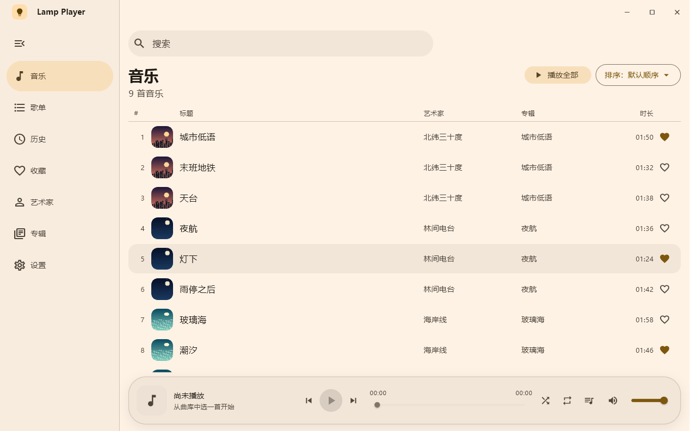
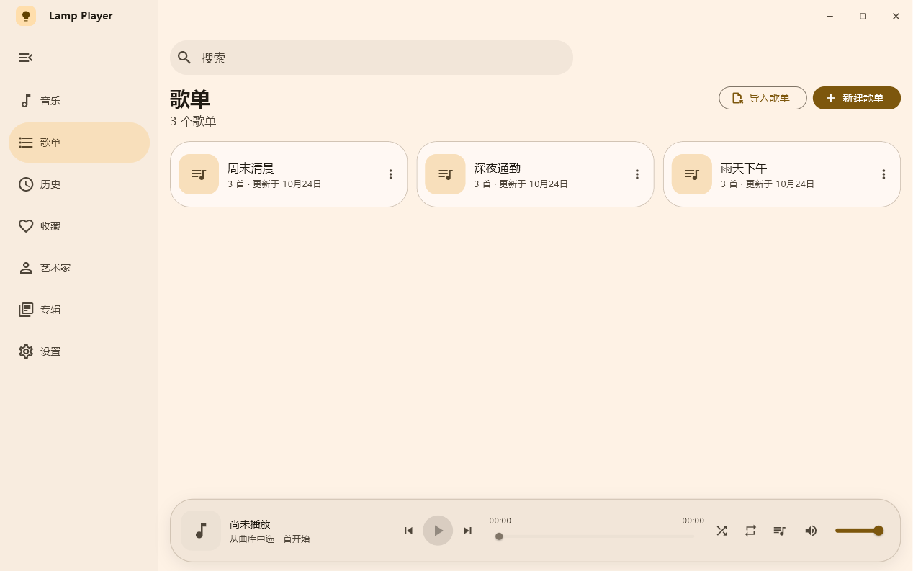
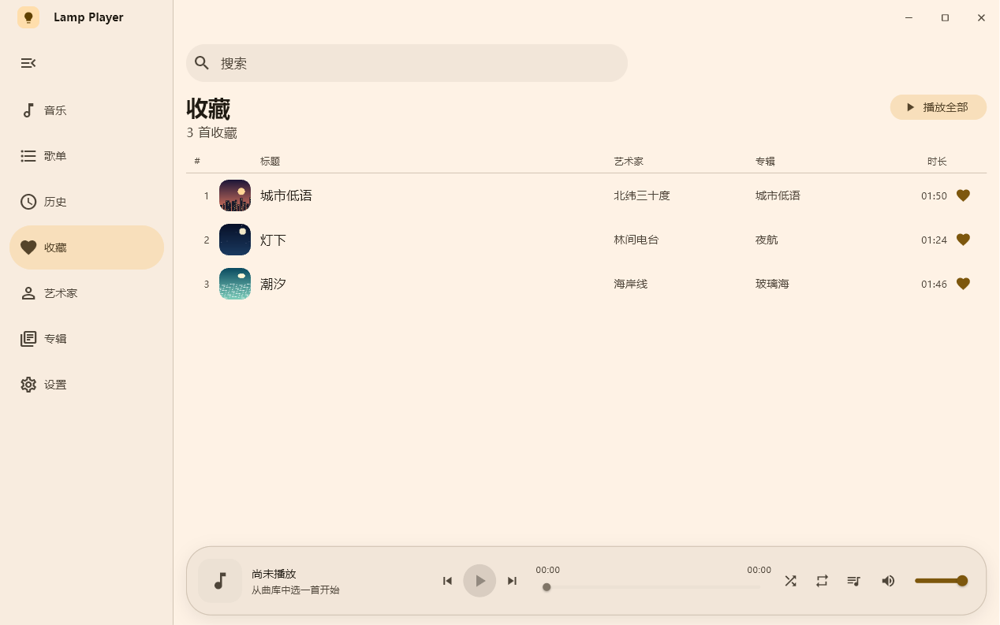
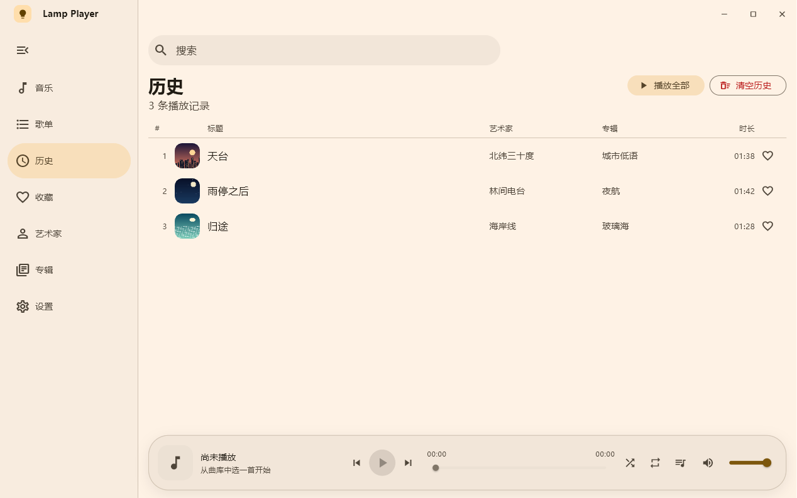
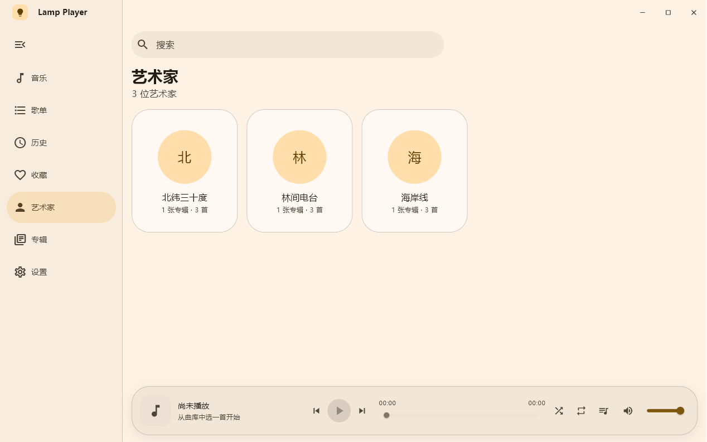
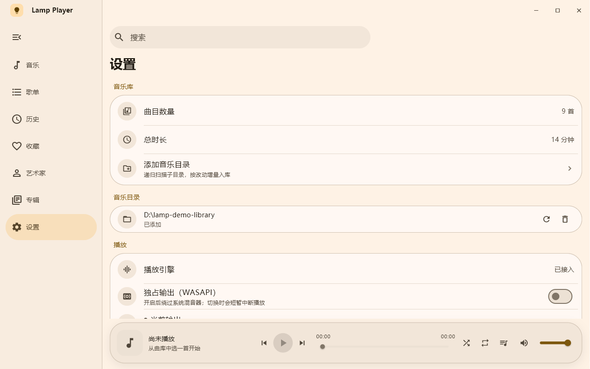

# Lamp Player 🎵

基于 **Flutter + Rust + BASS** 的本地音乐播放器。

[](https://github.com/Linecos/lamp-player/actions/workflows/ci.yml)
[](LICENSE)

> **当前状态**：M1 曲库闭环（含目录导入）与 M2 播放链路已完成；歌单 / 历史 / 收藏页面已接入，
> 播放队列、快捷键、会话恢复与专辑封面就位，正在进入 M3 打磨与发布。任务清单见 [docs/ROADMAP.md](docs/ROADMAP.md)。

## 界面预览

<p align="center">
  
</p>

<p align="center">
  
  
</p>

<p align="center">
  
  
</p>

<p align="center">
  
</p>

## 特性

- 🎨 Material 3 界面（Flutter），主题可选跟随系统 / 浅色 / 深色，重启后保留
- 📚 曲库视图：全部 / 艺术家 / 专辑，五种排序，万级曲目虚拟滚动
- 📥 添加音乐目录：系统目录选择 → 增量扫描入库，设置页与空态均可进入
- 🔎 FTS5 全文检索（歌名/歌手/专辑），输入 300ms 防抖
- 🔊 独占输出：可在设置页切到 WASAPI 独占（绕过系统混音器），设备不支持时自动回落共享
- 🎧 系统媒体控制（SMTC）：媒体键 / 耳机线控 / 任务栏缩略图按钮可控制播放，Windows 音量浮层显示曲目、封面
- 🧷 单实例 + 托盘：再次启动只会唤起已有窗口；关窗默认隐藏到托盘继续播放，托盘菜单可显示窗口或退出
- ▶️ 播放控制：上一首 / 下一首、播放全部、自动连播、随机播放与列表 / 单曲循环
- 🎛️ 播放队列面板：查看待播曲目、直接跳播，底栏角标显示队列长度
- ⌨️ 快捷键：空格播放/暂停、Ctrl+←/→ 切歌、←/→ 快进 5 秒、Ctrl+F 搜索、Ctrl+M 静音
- 🖱️ 曲目右键菜单：播放、下一首播放、加入队列、收藏、加入歌单、打开文件位置、复制路径
- 🖼️ 专辑封面：扫描时提取内嵌图，按内容哈希缓存并去重；列表与播放条显示，缺图回退音符图标；升级老曲库后首次启动静默补扫一次
- 💾 会话恢复：音量、静音前音量、上次曲目与进度、循环 / 随机、当前分区与侧栏状态；窗口尺寸与最大化状态（播放队列本身不持久化，重启后按曲库顺序续播）
- 🗂️ 歌单 / 收藏 / 播放历史页面（SQLite 存储层 + 页面接入）
- 🦀 Rust 负责核心逻辑：文件扫描、元数据解析、曲库、系统集成
- 🖥️ 首先支持 Windows，后续可扩展 Android / Linux

## 架构

```
┌─────────────────────────────┐
│   Flutter (Material 3 UI)   │  界面、交互、播放列表
└──────────────┬──────────────┘
               │ flutter_rust_bridge (类型安全 FFI)
┌──────────────▼──────────────┐
│          Rust Core          │
│  ├─ scan      文件扫描/标签  │
│  ├─ db        SQLite + FTS5 │
│  ├─ collections 用户数据 │
│  ├─ player    BASS 播放控制  │
│  └─ bass.rs   DLL 动态加载   │
└──────────────┬──────────────┘
               │ FFI (libloading)
┌──────────────▼──────────────┐
│     BASS (bass.dll)         │  解码 / 混音 / 低延迟输出
└─────────────────────────────┘
```

详细分层、数据流与扩展方式见 [docs/ARCHITECTURE.md](docs/ARCHITECTURE.md)；
Rust 与 Dart 之间的接口约定见 [docs/API_CONTRACT.md](docs/API_CONTRACT.md)。

## 技术栈

| 层 | 技术 |
|---|---|
| 界面 | Flutter 3.47 + Material 3 |
| 桥接 | flutter_rust_bridge v2.13 |
| 扫描 / 元数据 | Rust + `walkdir` / `lofty` |
| 曲库 | `rusqlite`（bundled SQLite + FTS5） |
| 音频 | [BASS](https://www.un4seen.com/) 2.4 |

## 快速开始

前置要求：Flutter SDK（含 Windows 桌面支持）、Rust（MSVC 工具链）、
Visual Studio 2022（C++ 桌面开发）、开启 Windows 开发者模式。

```powershell
git clone https://github.com/Linecos/lamp-player.git
cd lamp-player
.\scripts\bootstrap.ps1        # pub get + cargo fetch + 下载 BASS
flutter run -d windows
```

手动步骤（脚本做了什么）：

```powershell
flutter pub get
cargo fetch --manifest-path rust/Cargo.toml
.\scripts\setup-bass.ps1         # 从 un4seen 官网下载 BASS 2.4
.\scripts\setup-bass-output.ps1  # 独占输出所需 basswasapi / bassmix（可选）
```

> BASS 为闭源第三方库，不随仓库分发（`third_party/bass/` 已 gitignore）。
> `scripts/setup-bass.ps1` 会下载 BASS 与官方 add-on（flac/opus/ape/wma）并校验 SHA256；
> m4a/aac 播放还需要 `scripts/setup-bass-plugins.ps1` 补 `bass_aac.dll`。
> 构建时 CMake 自动把它们拷到 exe 目录。
> Rust 装在非默认位置时，需设置 `RUSTUP_HOME` / `CARGO_HOME`。

## 目录结构

```
├── lib/
│   ├── main.dart              入口：初始化桥接 + 挂载应用
│   └── src/
│       ├── app/               应用外壳、路由表
│       ├── theme/             Material 3 主题
│       ├── features/          页面（曲库、播放、设置）
│       ├── common/            通用组件与工具
│       └── rust/              frb 生成代码（禁止手改）
├── rust/
│   ├── src/api/               对 Dart 暴露的接口（db / collections / scan / player / model）
│   ├── src/bass.rs            BASS 动态加载封装（M2 实现）
│   └── tests/                 Rust 集成测试
├── test/                      纯 Dart 测试（不依赖原生库，CI 跑这个）
├── integration_test/          桌面端集成测试（需真实原生库）
├── windows/                   Windows 宿主工程
├── scripts/                   环境与检查脚本
├── docs/                      架构、接口契约、路线图
└── third_party/               第三方二进制（BASS，不入库）
```

## 参与贡献

欢迎任何人 fork 后提 PR，流程见 [CONTRIBUTING.md](CONTRIBUTING.md)：

1. 从 [docs/ROADMAP.md](docs/ROADMAP.md) 挑一个任务（标 **[入门]** 的适合第一次）；
2. 拉分支 `feat/xxx`，改完跑 `.\scripts\check.ps1`（等价 CI）；
3. 按 PR 模板提交，CI 四项全绿后由 owner review 合并。

提交信息用中文 + Conventional Commits，例如 `feat(曲库): 支持按目录增量扫描`。

## 许可证

本项目代码以 [MIT](LICENSE) 许可发布。

注意：BASS 音频库由 [Un4seen Developments](https://www.un4seen.com/) 版权所有，
采用其自有许可（非商用免费），与本项目的 MIT 许可相互独立。
